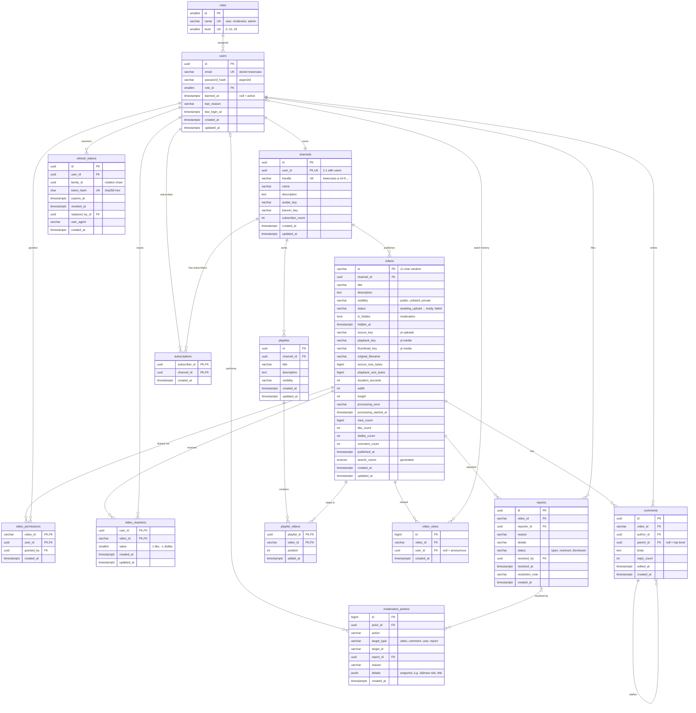

# Database design

> **Status: Approved — Stage 1, 2026-11-14.** PostgreSQL 17, SQLAlchemy 2.0 models, Alembic migrations.

## 1. What is stored where

| Store | Holds | Durability |
|---|---|---|
| **PostgreSQL** | Users, roles, channels, video metadata and state, permissions, reactions, comments, subscriptions, playlists, views, reports, audit log, refresh-token hashes, **object keys** (not bytes) | System of record, backed up |
| **MinIO `yt-uploads`** | Raw uploaded files, exactly as the browser sent them | Temporary: deleted after processing; lifecycle expiry after 2 days |
| **MinIO `yt-media`** | Processed `playback.mp4`, thumbnails (3 auto candidates + optional custom), channel avatars and banners | Durable, backed up |
| **Redis** | Celery queue, rate-limit counters, view-dedupe keys, processing progress % | Ephemeral; loss is tolerated |
| **Browser** | Access token (memory only), refresh token (HttpOnly cookie) | — |

Video binaries never enter PostgreSQL. The DB stores only keys such as `videos/aB3dE5fG7hJ/playback.mp4`.

## 2. ER diagram

## 3. Tables

Conventions:
- `timestamptz` everywhere (UTC). `created_at` uses the DB default `now()`; `updated_at` is set on update by SQLAlchemy.
- UUID keys (`gen_random_uuid()`) are non-enumerable and safe to expose. Videos use an 11-char URL-safe random id for YouTube-style URLs.
- Enumerations are stored as `varchar` + `CHECK` (SQLAlchemy `Enum(native_enum=False)`) rather than native PG enums, so adding a value is a simple migration.
- Every foreign key column has an index, which joins and `ON DELETE CASCADE` need.
- Constraint names follow a fixed naming convention (`pk_`, `fk_`, `uq_`, `ck_`, `ix_`), so Alembic autogenerate stays deterministic. Every migration is reviewed by hand.

### roles
Lookup table seeded by the first migration: `user` (level 0), `moderator` (10), `admin` (20). Permission checks compare `level`, so admin ⊇ moderator ⊇ user.

### users
The authentication identity only. The public profile lives in `channels`.
- `email` is unique, with `CHECK (email = lower(email))`. The app normalizes it before insert.
- `role_id` → `roles.id` `ON DELETE RESTRICT`, default `user`.
- `banned_at IS NULL` means active. Users are **never hard-deleted** (banning keeps the audit trail and content references intact).

### refresh_tokens
One row per issued refresh token, storing only the SHA-256 hash, never the token.
- `family_id` groups a rotation chain. Presenting a token that is already revoked → revoke the entire family (token theft detection).
- Indexes: `uq(token_hash)`, `ix(user_id)`, `ix(family_id)`. Expired rows are purged periodically.

### channels
1:1 with users (`uq(user_id)`, `ON DELETE CASCADE`), created automatically at registration.
- `handle`: `uq`, `CHECK (handle ~ '^[a-z0-9._-]{3,30}$')`.
- `subscriber_count`: denormalized, `CHECK (>= 0)`.

### videos
- `id varchar(11)`, `CHECK (id ~ '^[A-Za-z0-9_-]{11}$')`, generated with `secrets.token_urlsafe(8)`.
- `channel_id` → `channels` `ON DELETE CASCADE`.
- `title` 1–100 characters, `description` ≤ 5000 (both `CHECK`).
- `visibility` ∈ `public | unlisted | private`, **default `private`** (a draft is private until the owner publishes, as on YouTube).
- `status` ∈ `awaiting_upload | queued | processing | ready | failed` (state machine in [video-storage.md](video-storage.md#3-processing-state-machine)).
- `is_hidden` is a moderation flag, independent of the visibility the owner controls.
- Counters `view_count`, `like_count`, `dislike_count`, `comment_count` have `CHECK (>= 0)`.
- `published_at` is set the first time the video becomes `ready`, and the feed is ordered by it.
- `search_vector tsvector GENERATED ALWAYS AS (setweight(to_tsvector('simple', title), 'A') || setweight(to_tsvector('simple', description), 'B')) STORED`.

Indexes (each with the query it serves):

| Index | Serves |
|---|---|
| `ix_videos_feed (published_at DESC, id DESC) WHERE visibility='public' AND status='ready' AND NOT is_hidden` | Home feed keyset pagination |
| `ix_videos_channel_public (channel_id, published_at DESC) WHERE <same predicate>` | Channel page "Videos" tab |
| `ix_videos_popular (view_count DESC) WHERE <same predicate>` | "Popular" sort, related fallback |
| `ix_videos_channel_created (channel_id, created_at DESC)` | Studio (all states) |
| `ix_videos_search GIN (search_vector)` | Full-text search |
| `ix_videos_title_trgm GIN (title gin_trgm_ops)` | Partial and typo-tolerant title search, suggestions |
| `ix_videos_pipeline (status, created_at) WHERE status IN ('awaiting_upload','queued','processing')` | Cleanup and watchdog jobs |

### video_permissions
Explicit grants for private videos. PK `(video_id, user_id)`. `granted_by` → users `ON DELETE SET NULL`. `ix(user_id)` serves "Shared with me". Both FKs `ON DELETE CASCADE`.

### video_reactions
PK `(user_id, video_id)` guarantees one reaction per user per video. `value smallint CHECK (value IN (1, -1))`. Index `ix(video_id)` for cascades, and a partial index `ix(user_id, created_at DESC) WHERE value = 1` for "Liked videos".
The counter update is done in the same transaction as the row change: inserting a like → `like_count + 1`; switching → `like_count - 1, dislike_count + 1`; removing → the matching decrement.

### comments
- `video_id` → videos `CASCADE`, `author_id` → users `CASCADE`, `parent_id` → comments `CASCADE`.
- **The reply must belong to the same video, enforced in the DB:** `uq(id, video_id)` plus a composite FK `(parent_id, video_id) → comments(id, video_id)`. The service enforces a single level of nesting (as on YouTube).
- `body` 1–10 000 characters. Plain text only, rendered escaped.
- Indexes: `(video_id, created_at DESC) WHERE parent_id IS NULL` (top-level page), `(parent_id, created_at)` (replies), `(author_id)`.

### subscriptions
PK `(subscriber_id, channel_id)`, which makes subscribing idempotent by construction. `ix(channel_id)`. Self-subscription is rejected in the service (a cross-table rule cannot be a `CHECK`).

### playlists / playlist_videos
- `playlists.channel_id` → channels `CASCADE`, with `visibility` like videos.
- `playlist_videos`: PK `(playlist_id, video_id)` (no duplicates), `position int`, and `uq(playlist_id, position) DEFERRABLE INITIALLY DEFERRED`, so a reorder can swap positions inside one transaction. `ix(video_id)`.

### video_views
One row per **counted** view (after Redis dedupe), feeding `videos.view_count` and the user's History.
- `user_id` → users `ON DELETE SET NULL` (null = anonymous). No IP address is stored; dedupe uses a hashed key in Redis with a 24 h TTL.
- Indexes: `(video_id, created_at)` and `(user_id, created_at DESC) WHERE user_id IS NOT NULL` (History).

### reports
- `reason` ∈ `spam | sexual | violent | hateful | harassment | harmful | misinformation | copyright | other`, plus `details` ≤ 1000.
- `status` ∈ `open | resolved | dismissed`, with `resolved_by` → users `SET NULL`.
- **One open report per user per video:** a partial unique index `uq(video_id, reporter_id) WHERE status = 'open'`.
- `ix(status, created_at)` serves the moderation queue.

### moderation_actions (audit log)
Append-only and never updated or deleted by the application.
- `action` ∈ `hide_video | restore_video | delete_video | delete_comment | resolve_report | dismiss_report | change_role | ban_user | unban_user`.
- The target is **polymorphic on purpose** (`target_type`, `target_id` with no FK), because audit rows must survive deletion of the target. `details jsonb` keeps a snapshot such as the video title or old and new role.
- Indexes: `(target_type, target_id)`, `(created_at DESC)`, `(actor_id)`.

## 4. Deletion semantics

| Event | Database | Object storage |
|---|---|---|
| Owner/admin deletes a video | Row deleted → cascades to permissions, reactions, comments, playlist entries, views, reports. Audit row kept | `delete_video_objects` task removes `videos/{id}/` **after commit** (a retried task makes this idempotent) |
| Draft never uploaded | Removed by the beat cleanup after 24 h | Lifecycle rule expires raw objects after 2 days |
| User banned | `banned_at` set, refresh tokens revoked. Content remains (moderators can hide it) | — |
| Comment deleted | Row + replies (`CASCADE`), `comment_count` adjusted | — |

## 5. Migrations

- Alembic, one revision per meaningful schema change, and each revision is tested upgrade → downgrade → upgrade in CI.
- The `pg_trgm` extension is created in the first migration (`CREATE EXTENSION IF NOT EXISTS pg_trgm`, a trusted extension, so no superuser is needed).
- The generated `search_vector` column, partial indexes and deferrable constraints are written explicitly in the migration, because autogenerate does not cover them.
- `migrate` runs as a one-shot container before the API starts.
