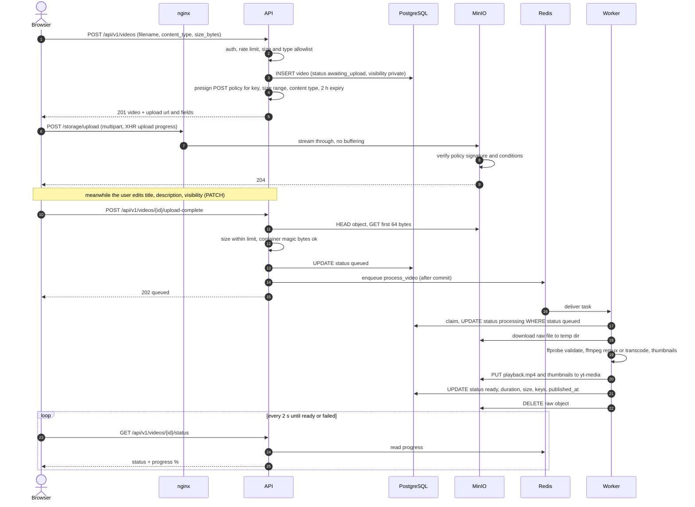
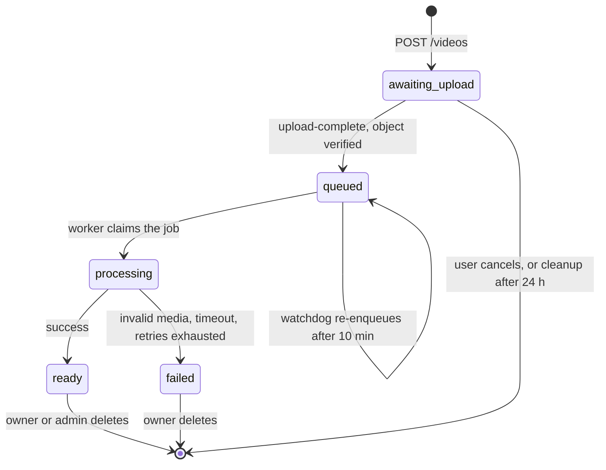
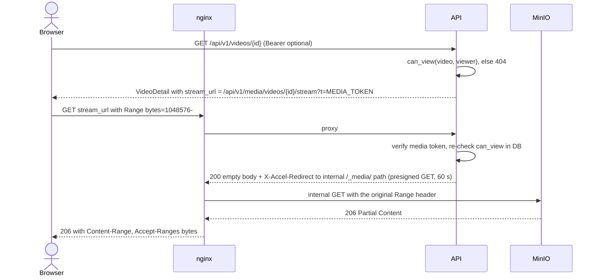

# Video upload, processing and delivery

> **Status: Approved — Stage 1, 2026-11-14.** This is the core of the system. Goal: bytes take the shortest safe path, and every decision about *who may read or write which bytes* is made by the API.

## 1. Object layout

| Bucket | Key | Written by | Read by | Lifetime |
|---|---|---|---|---|
| `yt-uploads` | `{video_id}/source` | Browser, via presigned POST only | Worker | Deleted after successful processing. Lifecycle expiry after 2 days |
| `yt-media` | `videos/{video_id}/playback.mp4` | Worker | nginx (via X-Accel) | Until the video is deleted |
| `yt-media` | `videos/{video_id}/thumb-{1,2,3}.jpg`, `thumb-custom.jpg` | Worker / API | nginx (via X-Accel) | Until the video is deleted |
| `yt-media` | `channels/{channel_id}/avatar.jpg`, `banner.jpg` | API (after re-encode) | nginx (via X-Accel) | Until replaced |

- Keys are built **only** from server-generated ids. User filenames never become paths; the sanitized original name is stored in the DB for display in Studio only.
- Both buckets are private (no anonymous policy). The API and worker use a dedicated MinIO user whose policy allows only these two buckets. MinIO root credentials are used only by `minio-init`.
- Raw (untrusted) and processed (served) bytes are in different buckets, and the browser can only POST into the raw one.

## 2. Upload flow

The UX follows YouTube Studio: as soon as a file is picked, the upload starts, and the user fills in the details while it progresses.



**Why a presigned POST and not a presigned PUT or an upload through the API**
- A POST policy lets **MinIO** enforce `content-length-range`, the exact key and the `Content-Type` prefix. A presigned PUT cannot limit size, and an upload through the API would put gigabytes through Python.
- POST policy signatures cover the policy document, not the host. The browser can therefore post to a **same-origin** path (`/storage/upload`) that nginx proxies to MinIO. This means no CORS, no MinIO hostname in responses, and it works on whatever IP the tester uses.
- nginx allows only `POST` on that location, with `proxy_request_buffering off` and `client_max_body_size` slightly above the limit.

**Validation layers** (each one cheap, the last one authoritative):

| Layer | Checks |
|---|---|
| UI | Extension and size, for UX only |
| `POST /videos` | Declared size ≤ `MAX_UPLOAD_BYTES`, MIME and extension allowlist, rate limit, title length |
| MinIO policy | Actual size within the range, exact key, content type prefix `video/`, expiry |
| `upload-complete` | The object exists, its real size is within the limit, magic bytes (`ftyp` for MP4/MOV, `1A45DFA3` for WebM/MKV, `RIFF…AVI`) |
| Worker (ffprobe) | Container format in the allowlist, has a video stream, duration ≤ `MAX_DURATION_SECONDS`, sane dimensions |

## 3. Processing state machine



- **Claiming is atomic:** `UPDATE videos SET status='processing' WHERE id=:id AND status='queued'`. If no row is affected, another worker already has it, so the task exits. This makes duplicate deliveries harmless (A6).
- **Enqueue happens after commit**, so the worker can never see a missing row. If enqueueing fails after the commit, the video stays `queued` and the watchdog re-enqueues it.
- **Retries** (exponential backoff, max 3) cover only transient errors (storage or network). Invalid media fails immediately with a user-readable `processing_error`.
- Celery settings: `acks_late=True`, `prefetch_multiplier=1`, soft and hard time limits of 30 and 35 min. A beat job marks `processing` rows older than the hard limit as `failed`.

## 4. Processing pipeline (worker)

1. Download `yt-uploads/{id}/source` to a per-task directory on the worker's scratch volume (`PROCESSING_WORKDIR`, `/scratch` in compose). It is deleted after the task; leftovers of a killed worker are purged at start-up and by the watchdog.
2. **Probe**: `ffprobe -v error -protocol_whitelist file -show_format -show_streams -of json <file>`. Reject if the format is not in the allowlist (`mov,mp4,m4a,3gp`, `matroska,webm`, `avi`), there is no video stream, or the duration is above the limit.
3. **Playback file**:
   - If the source is already browser-safe (H.264 `yuv420p` video + AAC/no audio), **remux** with `-c copy -movflags +faststart`. This takes seconds and loses no quality.
   - Otherwise **transcode** with `libx264 -preset veryfast -crf 23 -pix_fmt yuv420p`, scaled down to at most 720p (`scale='min(1280,iw)':-2`), `aac 128k`, `+faststart`.
   - Progress comes from `ffmpeg -progress pipe:1` (`out_time_ms` / duration) and is written to Redis `proc:{id}` for the status endpoint.
4. **Thumbnails**: three candidate frames at 25 / 50 / 75 % of the duration, 1280×720 JPEG (letter-boxed if needed). The default is #2 unless the owner uploaded a custom one.
5. Upload the outputs to `yt-media`, then in a single transaction set `ready`, the keys, `duration_seconds`, `width/height`, `playback_size_bytes` and `published_at`. Delete the raw object last.

ffmpeg hardening is covered in [security.md § Media processing](security.md#6-media-processing-hardening).

## 5. Playback (protected delivery with Range)



- **Media token**: a JWT signed with a *separate* secret, `{typ: "media", vid, sub | null, exp: 4h}`. It is needed because `<video>` cannot send an `Authorization` header. It identifies the viewer; it does **not** grant access by itself. Every request, including every seek, re-runs `can_view` against the DB, so revocation and moderation apply immediately (C4).
- **The presigned GET is internal only**: it is signed for host `minio:9000`, valid for 60 s, used by nginx within milliseconds, and never seen by the browser.
- nginx (abridged from [infra/nginx/nginx.conf](../infra/nginx/nginx.conf)):
  ```nginx
  # Upstreams are resolved per request (variable proxy_pass), so recreated
  # containers with new IPs never leave nginx returning 502.
  resolver 127.0.0.11 valid=10s ipv6=off;

  # Browser uploads: POST only; MinIO validates the signed policy.
  location = /storage/upload {
      limit_except POST { deny all; }
      client_max_body_size 2100m;
      proxy_request_buffering off;
      set $storage_upload http://minio:9000;
      proxy_pass $storage_upload/yt-uploads;
      proxy_hide_header Location;            # never reveal storage URLs (B2)
      proxy_hide_header x-amz-request-id;
  }

  # Reachable only through X-Accel-Redirect from the API.
  location ~ ^/_media/(.*)$ {
      internal;
      set $storage minio:9000;
      proxy_pass http://$storage/$1$is_args$args;  # path/query unmodified: signature intact
      proxy_set_header Host minio:9000;
      proxy_set_header Authorization "";
      proxy_hide_header x-amz-request-id;
      proxy_hide_header x-amz-id-2;
  }
  ```
  Verified on the running stack: `Range: bytes=0-1023` returns `206` with `Content-Range: bytes 0-1023/<size>` and no storage headers.
  Server-built object keys (`[A-Za-z0-9/_.-]` only) are what makes forwarding the presigned path unmodified safe.
- **`MEDIA_DELIVERY=proxy`** (dev and tests without nginx): the same endpoint streams from MinIO through FastAPI, forwarding `Range` and returning `206` + `Content-Range`. The authorization code path is identical.

**Why not HLS:** HLS would need authorizing every segment request (or signed segment URLs and playlist rewriting). A progressive MP4 with `faststart` + Range gives instant start and seeking with one URL to protect. Adaptive bitrate is the main thing lost and is listed as future work.

**Why not stream everything through FastAPI:** Python would hold a connection per viewer and copy every byte. nginx does this natively with sendfile-like efficiency, so the API only answers "yes/no" in about 1 ms.

## 6. Limits (configurable in `.env`)

| Setting | Default |
|---|---|
| `MAX_UPLOAD_BYTES` | 2 GiB |
| `MAX_DURATION_SECONDS` | 7200 |
| Accepted types | mp4, mov/m4v, webm, mkv, avi |
| Upload policy expiry | 2 h |
| Media token TTL | 4 h |
| Internal presigned GET TTL | 60 s |
| Custom thumbnail / avatar / banner | ≤ 2 / 2 / 6 MB, jpeg/png/webp, re-encoded to JPEG |
| Processing time limit | 30 min soft / 35 min hard |
| Worker concurrency | 2 (CPU-bound; set per machine) |

## 7. Failure handling

| Failure | Result |
|---|---|
| Browser closes mid-upload | Draft stays `awaiting_upload`; the cleanup job deletes it after 24 h, and the lifecycle rule removes partial objects |
| `upload-complete` without an object | `409 upload_not_found`, and the client may retry the upload |
| Fake or corrupt media | `failed` with a reason shown in Studio; the raw object is kept until lifecycle expiry for debugging |
| Worker crashes mid-job | `acks_late` redelivers. A row left in `processing` past the hard limit is marked `failed` by beat |
| MinIO temporarily down | Task retries with backoff. API presign/HEAD returns `503` |
| Object deletion fails after the DB delete | Task retries. The idempotent delete-by-prefix makes reruns safe |

## 8. Future work (explicitly out of scope)

Resumable multipart uploads, multiple renditions / adaptive bitrate (HLS/DASH), a CDN in front of nginx, per-user storage quotas.
